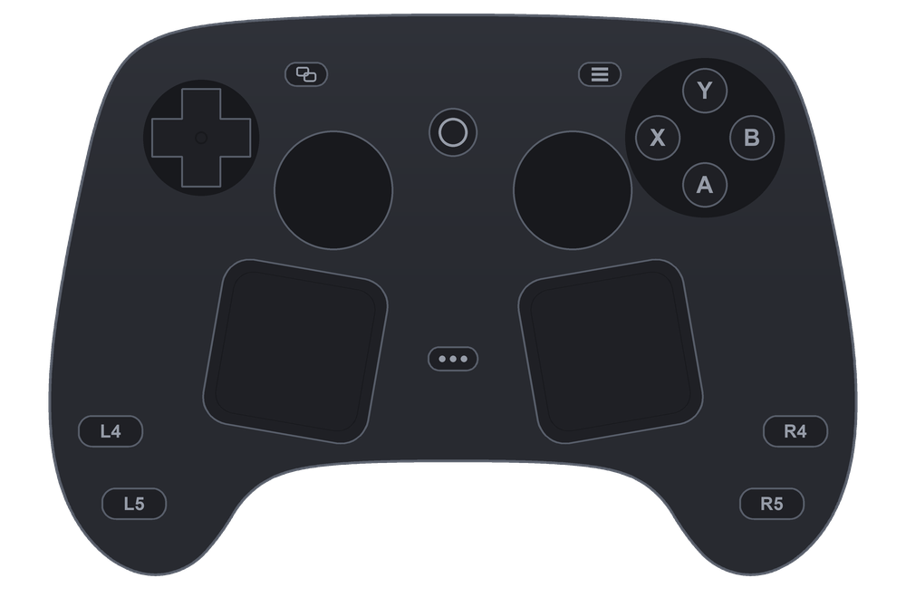
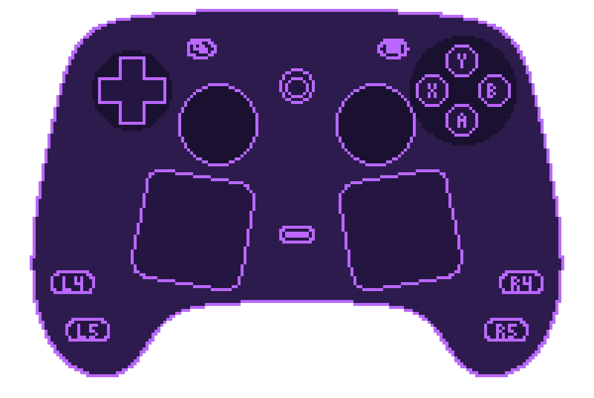
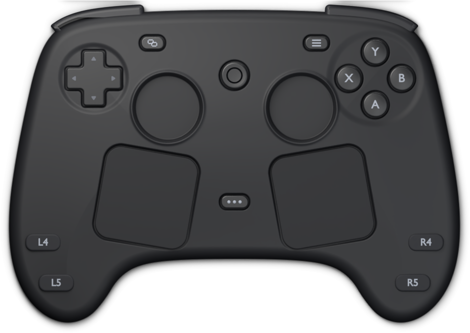
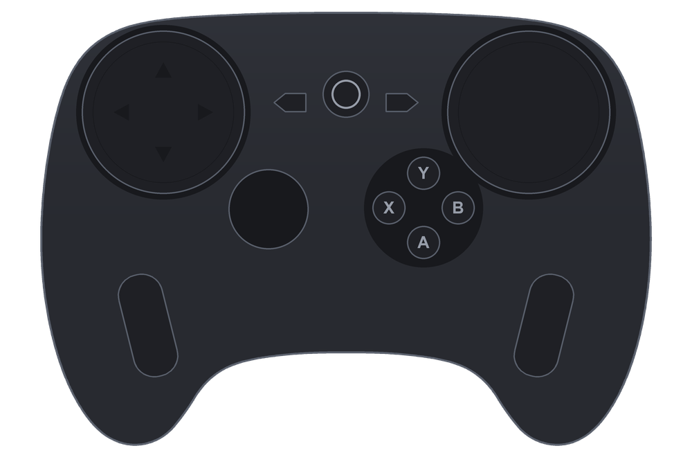
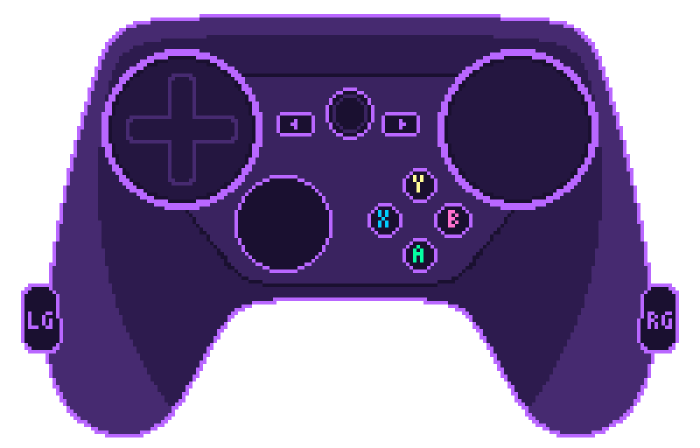
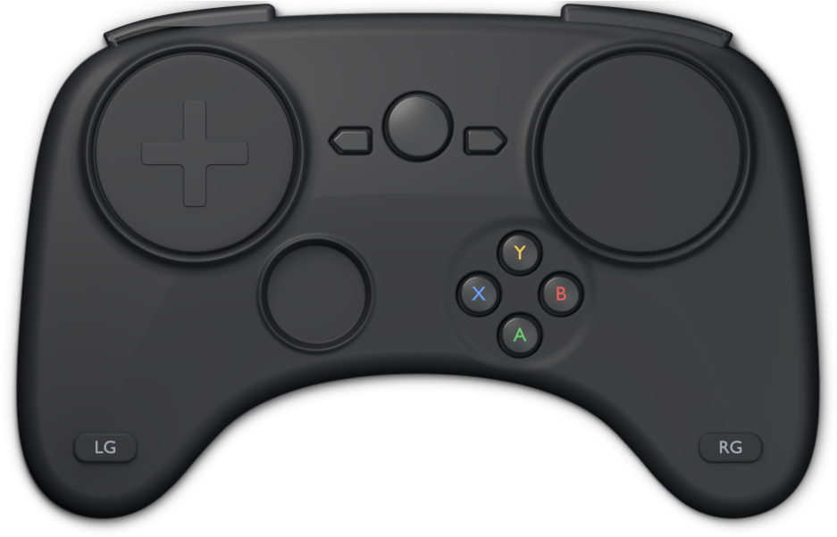

# Theme gallery

Every image below is the base art of a bundled theme, shown as it ships — on stream, button
presses, trackpad touches, grips and gyro light up on it in real time. Where each image comes
from is listed under [Artwork in THIRD-PARTY-NOTICES.md](../THIRD-PARTY-NOTICES.md#artwork).

## Steam Controller (2026)

PadSight originals, drawn or rendered from code:

  
  
  

Graphite · Vaporwave Pixel · Realistic

## Steam Controller (2015)

PadSight originals:

  
  
  

From VSCView, by their authors:

  
  

Default (black) by [Al. Lopez (AL2009man)](https://github.com/AL2009man) · Line Art by
[Ishmobile](https://www.youtube.com/channel/UCTAPOuAcWv9JGdiQsVVSxkQ)

## Steam Deck

  

Default (black) by [Al. Lopez (AL2009man)](https://github.com/AL2009man)

## DualSense

  

Default (midnight black; also in white, cosmic red, galactic purple, nova pink and starlight blue)
by [Al. Lopez (AL2009man)](https://github.com/AL2009man)

## DualShock 4

  

Default (V2, jet black; V1 and more colours bundled) by
[Al. Lopez (AL2009man)](https://github.com/AL2009man)

## Xbox Wireless Controller

  

Default (Series X|S; Xbox One and One S colours bundled) by
[Al. Lopez (AL2009man)](https://github.com/AL2009man)

## Xbox 360 Controller

  

Default (black and white) by [Al. Lopez (AL2009man)](https://github.com/AL2009man)

## Nintendo Switch Pro Controller and Joy-Con

  
  

Defaults by [Al. Lopez (AL2009man)](https://github.com/AL2009man) — the Joy-Con also ships in
grip, left, right and horizontal layouts

## Arcade stick

The arcade-stick themes are glyph plates (PlayStation, Xbox, Switch and glyphless) rather than
one body image; see them in the app's theme browser. By
[Al. Lopez (AL2009man)](https://github.com/AL2009man).
